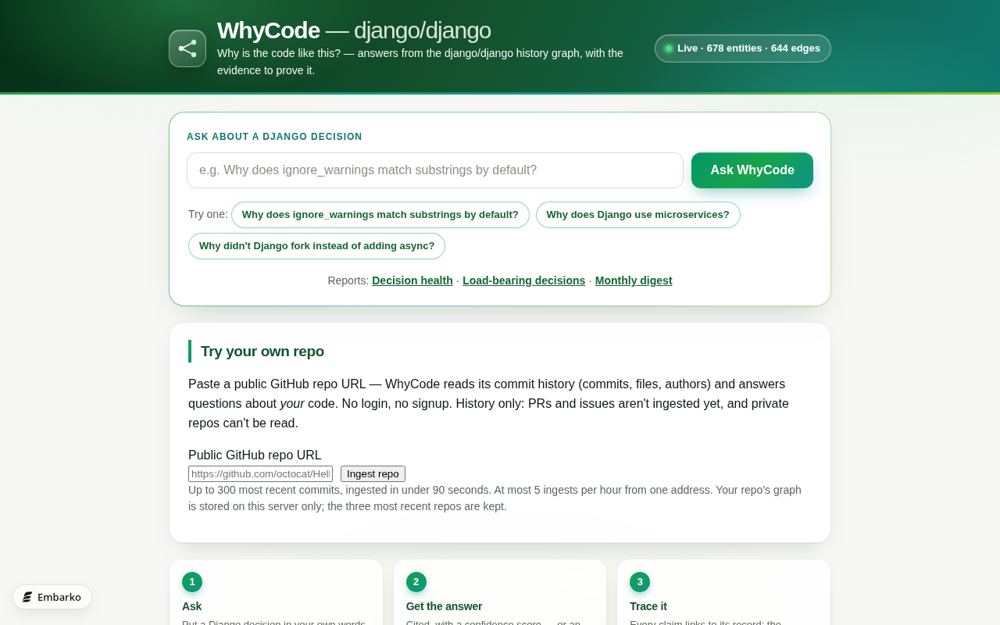

# WhyCode

> Git remembers what changed. WhyCode remembers why.

WhyCode answers the question every codebase eventually asks — *"why is the code like this?"* — with an answer quoted from the project's own record: a cited evidence chain, a confidence score, and an honest refusal when the evidence isn't there.

**Live demo:** https://whycode.embarko.app — ask about the Django demo, or paste a public GitHub repo URL and ask about your own code. No account, no sign-up.



## What it does

WhyCode ingests a repository's commits, pull requests, tickets and design documents into a knowledge graph, then answers "why" questions from that graph. Every claim in an answer links back to the commit, PR, ticket or design doc it came from.

The demo corpus is django/django: 678 entities and 644 edges — 200 commits, 100 PRs, 100 Trac tickets, 161 files, 90 people, 27 DEPs.

Try it:

- "Why does Django need a steering council?" — answered at 0.99 confidence, with a banner noting DEP 0019 supersedes DEP 0010 and DEP 0012.
- "Why didn't Django fork instead of adding async?" — the rejected alternative, quoted from DEP 0009.
- "Why should Django move to microservices?" — refused. No evidence, no invented answer.

## Features

- **Cited evidence chain** — every answer shows the records it was built from, with a confidence score and a graph view of the chain.
- **Blast radius** — the files, commits and issues a change touches, and who to ask about them.
- **Show the query** — the exact SQL or Cypher that produced the answer, visible under each answer.
- **Load-bearing decisions** (`/decisions`) — the ten decisions the graph leans on most, ranked by PageRank.
- **Decision health** (`/health`) — when a decision was made and how often the code it governs has changed since. Facts only, never a verdict.
- **Evidence grades** — each chain record graded A–D by how directly it supports the answer.
- **Why not** — alternatives a design doc proposed and rejected, quoted verbatim, plus a dated timeline of each decision.
- **Superseded decisions** — when a decision was replaced, the answer says so and links to the replacement.
- **Honest refusal** — if a question has no grounding in the record, WhyCode says so instead of guessing.
- **Reports** — decision health, load-bearing decisions and a monthly digest, under Reports.

## Bring your own repo

Paste any public GitHub repository URL on the home page. WhyCode clones its history — commits, files and authors, up to 300 commits — into a per-repo graph and answers the same "why" questions about your code. Switch back to the Django demo at any time.

Current limits, stated plainly: history only (no pull requests, issues or file contents), public repositories only, and no automatic re-sync on push yet. Nothing from a repository is ever executed.

## How it works

```text
ingest.py → trac.py → deps.py → graph.py   # SQLite graph: entities + edges
qa.py                                        # asking, ranking, refusal
app.py                                       # Flask web UI
whycode/neo4j_chain.py                       # Neo4j mirror and serving
whycode/byo.py                               # bring-your-own-repo ingest
whycode/mcp_server.py  whycode/prbot.py      # MCP server, PR bot
```

The UI reads its answers from `qa.py`. The graph is stored in SQLite, which is the source of truth. A Neo4j mirror serves the same graph over Cypher for the MCP server; the web app falls back to SQLite if Neo4j is unreachable.

## MCP server and PR bot

- **MCP server** (FastMCP, streamable HTTP): https://whycode-mcp.onrender.com/mcp — four tools on the same graph and the same refusal rules: `why_code`, `blast_radius`, `who_knows`, `decision_health`.
- **GitHub PR bot**: a HMAC-verified webhook (`POST /github-webhook`) comments on a pull request only when a cited decision governs the files it touches — with blast radius and who to ask. It never blocks a merge.

## Security

Scored 99/100 on an independent ArgosX scan (baseline 81; all 13 findings fixed). Security headers (HSTS, CSP, X-Frame-Options, nosniff, Permissions-Policy, Referrer-Policy), robots.txt and sitemap.xml included; axe-core reports zero accessibility violations. The official report is in `docs/argosx-scan-report/`.

## Run it locally

```bash
git clone https://github.com/eres0045/hackfront-fortec.git
cd hackfront-fortec
pip install -r requirements.txt
python app.py          # http://localhost:5000 (PORT honoured)
```

The bundled `data/whycode.db` contains the demo graph, so the demo runs with no credentials and no network calls. To rebuild it from scratch:

```bash
python -m whycode.ingest --repo django/django --db data/whycode.db
python -m whycode.trac --db data/whycode.db --limit 100
```

Or ask from the command line:

```bash
python -m whycode.cli --db data/whycode.db --question "Why ...?"
```

Environment variables: `WHYCODE_DB` (SQLite path), `PORT`, `NEO4J_URI` / `NEO4J_USERNAME` / `NEO4J_PASSWORD` (optional — falls back to SQLite). MCP server: `pip install -r requirements-mcp.txt`, then `uvicorn whycode.mcp_server:app`.

## Tests

```bash
python -m pytest tests/ -q
```

121 passed, 7 skipped. The skipped tests need live Neo4j credentials.

## Docs

- `docs/finale-build-plan-v2-ui/` — the one-page Finale Build Plan
- `docs/finale-build-plan-detailed/` — the full detail behind it
- `docs/argosx-scan-report/` — ArgosX reports
- `docs/finale-notes.md` — build log
- `docs/oss-gold-research.md` — open-source components evaluated

## License

MIT — see `LICENSE`.

Built by Team FORTEC (Ronit Shrimankar + Udita Singh) for the hackFront India Grand Finale, IIIT Delhi, November 2026.
